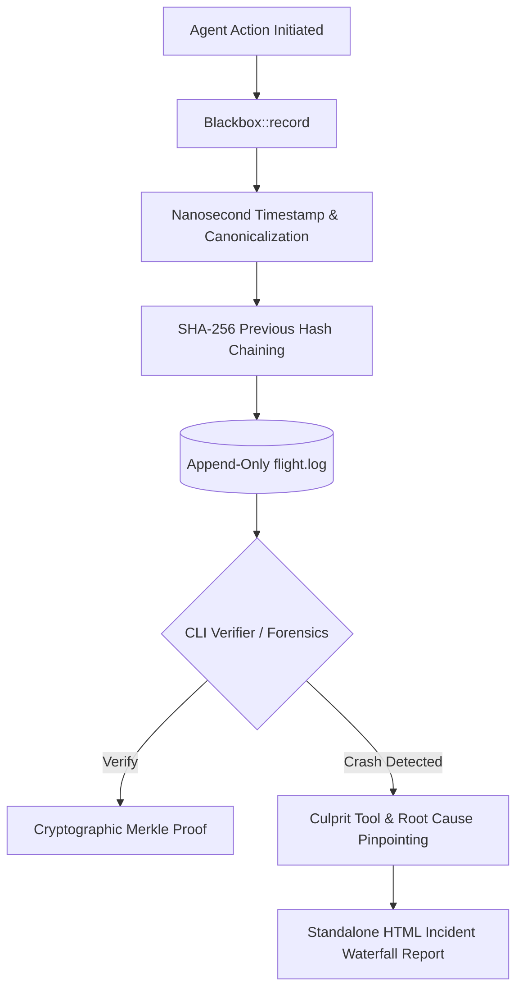

[🇸🇦 العربية](README.ar.md) | [🇬🇧 English](README.md)

# ⬛ eidcloud-agent-blackbox

> Immutable tamper-evident AI agent flight recorder and crash forensics engine with Merkle hash-chaining in pure PHP (Zero external vendor dependencies).

[](https://github.com/eidcloud/eidcloud-agent-blackbox)
[](https://www.php.net/)
[](LICENSE)
[](https://colab.research.google.com/github/eidcloud/eidcloud-agent-blackbox/blob/main/notebooks/quickstart.ipynb)

---

## 📌 Topics
`eidcloud` &bull; `agent-blackbox` &bull; `flight-recorder` &bull; `ai-audit` &bull; `tamper-evident` &bull; `agent-forensics` &bull; `php8`

---

## 🚀 Overview

**EidCloud Agent Black Box** is a lightweight, tamper-evident, append-only flight recorder engineered specifically for Autonomous AI Agents and Agentic Multi-Step Workflows. Built in pure PHP 8.2+ without any external dependencies, it captures nanosecond-precision telemetry across prompt inputs, context injections, tool invocations, shell executions, filesystem mutations, egress networking, and catastrophic crashes.

Every event is cryptographically linked in a **SHA-256 Merkle chain**, making log tampering mathematically detectable during security audits.



---

## 🛠 Features & Capabilities

- **Immutable Flight Recording**: Nanosecond-precision recording (`hrtime`) of prompts, context frames, tool calls, shell runs, FS mutations, network requests, tokens, and errors.
- **Tamper-Evident SHA-256 Merkle Chaining**: Cryptographic parent-child block hashing detects modifications, deletions, or sequence injection attacks.
- **Deterministic Crash Forensics**: Automatically correlates fatal exceptions with the culprit tool call, arguments, and stack trace that precipitated the failure.
- **Rich HTML Incident Reports**: Generates interactive single-file HTML reports featuring execution waterfall timelines, cryptographic verification badges, and token breakdown charts.
- **Zero Dependencies**: Pure PHP 8.2+ with PSR-4 autoloading. Runs everywhere out of the box.
- **Powerful CLI Tool**: Built-in `bin/eidcloud-blackbox` for automated CI/CD audits, log validation, and emergency post-mortems.

---

## 📦 Installation

Ensure you have PHP 8.2 or higher:

```bash
git clone https://github.com/eidcloud/eidcloud-agent-blackbox.git
cd eidcloud-agent-blackbox
```

Or install via Composer:

```bash
composer require eidcloud/agent-blackbox
```

---

## 💻 Programmatic Usage

```php
<?php

use EidCloud\AgentBlackbox\Blackbox;

// 1. Initialize blackbox flight recorder with an append-only log file
$bb = new Blackbox(__DIR__ . '/flight.log');

// 2. Record agent workflow steps
$bb->recordPromptInput("Fetch Q3 earnings report and execute sentiment model");

$bb->recordToolInvocation("fetch_filings", ["ticker" => "AAPL", "year" => 2026]);

$bb->recordShellExecution("python3 sentiment.py", 0, "Sentiment Score: +0.87");

$bb->recordNetworkEgress("POST", "https://api.internal/webhook", 200);

$bb->recordTokenExpenditure(1250, 420, "gemini-1.5-pro");

// 3. Catch and record crashes with full contextual attribution
try {
    throw new RuntimeException("Database connection timeout during state persistence");
} catch (\Throwable $e) {
    $bb->recordCrash($e);
}

// 4. Cryptographic integrity check
$integrity = $bb->verify();
if ($integrity['valid']) {
    echo "Flight log Merkle chain valid!\n";
}

// 5. Export interactive HTML Incident Report
$bb->exportHtmlReport(__DIR__ . '/incident.html');
```

---

## 🖥 CLI Usage

The repository includes `bin/eidcloud-blackbox`:

### 1. Inspect Flight Log
```bash
php bin/eidcloud-blackbox inspect flight.log
```

### 2. Verify Cryptographic Integrity
```bash
php bin/eidcloud-blackbox verify flight.log
```

### 3. Generate Forensic Incident Report
```bash
php bin/eidcloud-blackbox incident-report flight.log --html=incident.html
```

---

## 🧪 Testing

Run the zero-dependency test runner:

```bash
php tests/run_tests.php
```

---

## 👨‍💻 Author & Maintainer

- **Eng. MHD. Shadi AL-Hasan** ([@eidcloud](https://github.com/eidcloud))

---

## 📄 License

This project is licensed under the MIT License - see the [LICENSE](LICENSE) file for details.

---

## 👤 Author & Maintainer

**Eng. MHD. Shadi AL-Hasan**  
- **Role:** Executive CTO & Enterprise Solutions Architect  
- **Email:** [mhd.shadi.alhasan@gmail.com](mailto:mhd.shadi.alhasan@gmail.com)  
- **Phone / WhatsApp:** [+963934005922](tel:+963934005922)  
- **Location:** Damascus, Syria  
- **GitHub:** [shadialhasan](https://github.com/shadialhasan)  

---

## 📄 License

This project is licensed under the MIT License - see the [LICENSE](LICENSE) file for details.  
Copyright (c) 2026 **MHD. Shadi AL-Hasan**. All rights reserved.
